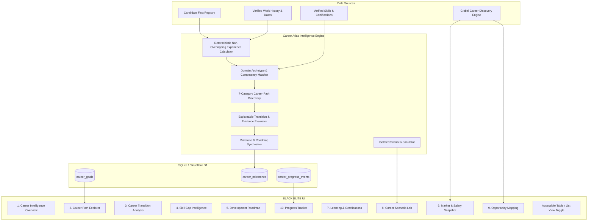

# ApplyVise AI — Career Atlas 2.0 Architecture & Systems Design

## 1. System Vision & Purpose

Career Atlas 2.0 transforms ApplyVise from a point-in-time application tracker into an end-to-end career intelligence, trajectory planning, and development ecosystem. Rather than offering superficial, static 5-node diagrams or hallucinated skill alignment metrics, Career Atlas 2.0 operates strictly on candidate ground-truth facts extracted and verified in the **Candidate Fact Registry** and the **Global Career Discovery Engine (GCDE)**.

### Core Architectural Mandates
1. **Fact Registry Grounding**: Career assessments, transferable competency derivations, and gap calculations draw strictly from verified candidate work history, verified skills, and accredited certifications.
2. **Zero Hallucination / Zero Metric Fabrication**: Scores are deterministic, explainable, and bound to verifiable criteria. If candidate profile information is insufficient, the system presents an explicit profile-completion requirement instead of generating arbitrary suggestions.
3. **Simulation Isolation**: Career Scenario Lab runs "what-if" models in isolated ephemeral memory, allowing candidate exploration of target countries, remote preferences, and speculative skills without contaminating the candidate's canonical Fact Registry.
4. **Universal Accessibility**: Every graph and visual model provides an accessible, high-contrast, keyboard-navigable table and list view.
5. **Runtime Parity**: Canonical REST endpoints exist in identical form across both Node.js (`server.ts`) and Cloudflare Workers (`worker/index.ts`).

---

## 2. High-Level System Architecture



---

## 3. Data Flow & Subsystem Boundaries

1. **Profile Intake & Experience Analysis**:
   - Computes non-overlapping calendar employment periods down to the month.
   - Detects current primary domain (Supply Chain Operations, Software Engineering, Product Management, Data & AI, Cloud & DevOps, Leadership/Executive, Financial Operations, or General Operations).
2. **Path Discovery & Categorization**:
   - Recommends transitions across 7 explicit categories: Vertical Promotion, Adjacent Functional, Cross-Functional Pivot, Management Track, Technical Specialist, Industry Transition, and Executive Leadership.
   - Assigns unambiguous readiness tags: `READY_NOW` (>=80% verified overlap), `GROWTH_PATH` (55-79%), `ASPIRATIONAL` (35-54%), or `PREPARATION_REQUIRED` (<35%).
3. **Evidence-Based Transition Analysis**:
   - Compares candidate verified competencies against target expectations.
   - Categorizes each competency into 4 unambiguous evidence tiers:
     - `STRONG_EVIDENCE`: Explicitly proven in multiple verified roles or accredited certifications.
     - `PARTIAL_EVIDENCE`: Adjacent skill or single occurrence in historical record.
     - `MISSING_EVIDENCE`: Essential capability not present in verified profile.
     - `CONFIRMATION_REQUIRED`: Inferred from domain context but lacking candidate verification.
4. **Personalized 4-Stage Roadmap Synthesis**:
   - Generates 30-Day Foundation, 90-Day Competency Building, 6-Month Real-World Projects, and 12-Month Market Positioning milestones.
   - Tracks interactive status (`not_started`, `in_progress`, `completed`, `skipped`) with user notes, completion dates, and verified evidence links.
5. **Scenario Simulation Isolation**:
   - Allows users to simulate added skills, certifications, target countries, remote preferences, and study hours.
   - Calculates dynamic readiness and estimated transition timelines strictly in memory.
   - Strictly preserves Fact Registry integrity.

---

## 4. Database Schema Specifications

```sql
-- Target Career Path Goals
CREATE TABLE IF NOT EXISTS career_goals (
  id TEXT PRIMARY KEY,
  user_id TEXT NOT NULL,
  target_role TEXT NOT NULL,
  category TEXT NOT NULL,
  readiness_status TEXT NOT NULL,
  match_score REAL NOT NULL,
  notes TEXT,
  created_at TEXT NOT NULL,
  updated_at TEXT NOT NULL
);

-- Development Milestones
CREATE TABLE IF NOT EXISTS career_milestones (
  id TEXT PRIMARY KEY,
  user_id TEXT NOT NULL,
  goal_id TEXT NOT NULL,
  phase TEXT NOT NULL, -- '30d' | '90d' | '6m' | '12m'
  title TEXT NOT NULL,
  description TEXT NOT NULL,
  category TEXT NOT NULL, -- 'skill' | 'project' | 'certification' | 'networking'
  estimated_hours INTEGER NOT NULL,
  status TEXT NOT NULL DEFAULT 'not_started',
  completion_notes TEXT,
  completed_at TEXT,
  created_at TEXT NOT NULL,
  updated_at TEXT NOT NULL
);

-- Career Progress Events
CREATE TABLE IF NOT EXISTS career_progress_events (
  id TEXT PRIMARY KEY,
  user_id TEXT NOT NULL,
  event_type TEXT NOT NULL, -- 'milestone_completed' | 'skill_verified' | 'goal_set' | 'readiness_increased'
  title TEXT NOT NULL,
  description TEXT NOT NULL,
  metadata TEXT, -- JSON
  created_at TEXT NOT NULL
);
```

---

## 5. Security & Verification Guardrails

1. **Multi-Tenant User Isolation**: Every database read/write is strictly scoped by authenticated `user_id` extracted from verified JWT session tokens.
2. **Zero Injected Data**: Untrusted client parameters cannot mutate baseline candidate employment records.
3. **Zero Phantom Roles**: Path generation enforces real domain archetypes with validated market taxonomies.
4. **Admin Telemetry & Health**: Comprehensive diagnostic endpoints expose active goals, milestone completion rates, and engine latencies in the Admin Console.
