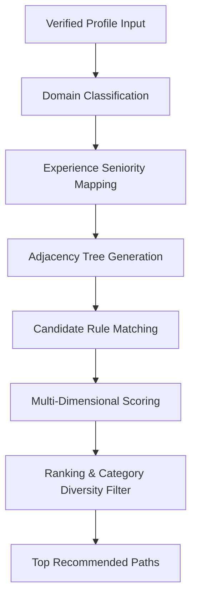

# ApplyVise AI — Career Path Recommendation Model

## 1. Algorithmic Overview

The Career Path Recommendation Model discovers, ranks, and personalizes realistic career trajectories based on verified candidate grounding.

Unlike generic LLM prompting that dreams up unrelated or grandiose roles (e.g., suggesting a junior QA engineer pivot directly to VP of AI Research), the ApplyVise recommendation model uses deterministic candidate grounding, domain adjacency trees, and verifiable skill bridges.

---

## 2. Recommendation Scoring Pipeline

### Multi-Dimensional Scoring Function

For any candidate $C$ and target role $R$, the overall readiness score $S(C, R)$ is computed as:

$$S(C, R) = w_s \cdot M_{\text{skills}}(C, R) + w_e \cdot M_{\text{exp}}(C, R) + w_d \cdot M_{\text{domain}}(C, R)$$

Where:
- $M_{\text{skills}}(C, R)$ is the Jaccard-weighted overlap of verified competencies:
  $$\frac{|\text{Verified}(C) \cap \text{Required}(R)| + 0.5 \cdot |\text{Adjacent}(C) \cap \text{Required}(R)|}{|\text{Required}(R)|}$$
- $M_{\text{exp}}(C, R)$ is the normalized experience alignment score:
  $$\min\left(1.0, \frac{\text{VerifiedYears}(C)}{\text{MinRequiredYears}(R)}\right)$$
- $M_{\text{domain}}(C, R)$ is domain proximity ($1.0$ for identical domain, $0.8$ for adjacent functional, $0.5$ for cross-functional).
- Standard weights: $w_s = 0.50$, $w_e = 0.30$, $w_d = 0.20$.

---

## 3. Readiness Status Thresholds

Every discovered trajectory is categorized into one of 4 unambiguous readiness tags:

| Threshold | Readiness Status | Actionable Advice |
|---|---|---|
| **$S \ge 80\%$** | `READY_NOW` | Candidate possesses sufficient verified competency to apply directly to open vacancies today. |
| **$55\% \le S < 80\%$** | `GROWTH_PATH` | Strong foundational alignment with 1-2 addressable skill gaps. Achievable within 3-6 months. |
| **$35\% \le S < 55\%$** | `ASPIRATIONAL` | Substantial transition requiring new domain mastery and 6-12 months of structured development. |
| **$S < 35\%$** | `PREPARATION_REQUIRED` | Fundamental realignment needed; prioritize core prerequisite milestones before applying. |

---

## 4. Diversity Enforcement & Category Quotas

To prevent path homogenization (e.g., showing 5 nearly identical vertical promotion roles), the recommendation engine enforces category diversity:
- At least 1 Vertical Promotion path.
- At least 1 Adjacent Functional path.
- At least 1 Cross-Functional Pivot path.
- At least 1 Management or Specialist track path depending on candidate seniority.
- Maximum 2 paths per category in the default overview.

---

## 5. Candidate Fact Registry Immutability

During exploration, candidates can save paths to their active career goals (`career_goals` table). This bookmarking action stores the candidate's chosen direction and generates a custom roadmap, but **never mutates or overwrites verified profile facts**.
