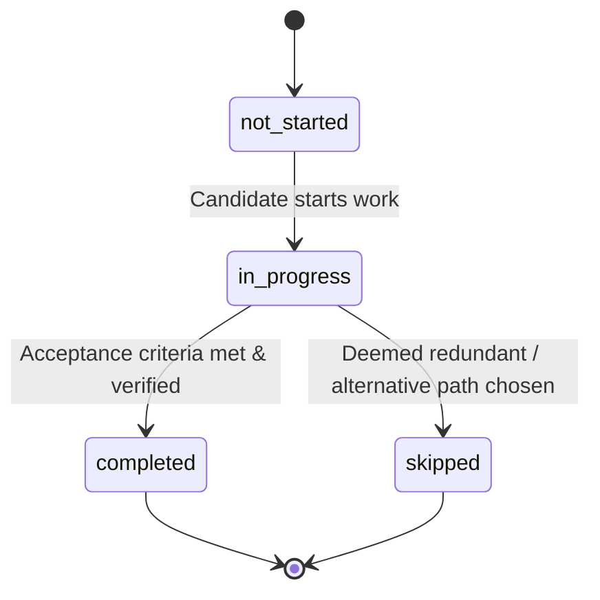

# ApplyVise AI — Career Development Roadmap Specification

## 1. Overview & Pedagogical Design

The Career Development Roadmap transforms abstract career goals into structured, phased, actionable steps. Every milestone is tailored to the candidate's exact verified gaps for a specific target role.

---

## 2. Four Phased Horizons

The roadmap is structured across 4 progressive temporal horizons:

### Phase 1: 30-Day Foundation (Immediate Wins)
- **Objective**: Establish foundational theoretical understanding and audit existing skills.
- **Milestone Types**:
  - Essential concept synthesis via verified free resources.
  - Development environment or analytical tooling setup (e.g., Python, SQL, Tableau, SAP sandboxes).
  - Profile & portfolio baseline updates.
- **Estimated Commitment**: 10–25 hours total.

### Phase 2: 90-Day Competency Building (Deep Practice)
- **Objective**: Bridge primary technical and domain gaps through structured practice.
- **Milestone Types**:
  - Completion of targeted, accredited certification or lab coursework.
  - End-to-end synthetic business case study or code repository creation.
  - Peer review or technical mentorship session.
- **Estimated Commitment**: 30–60 hours total.

### Phase 3: 6-Month Real-World Projects (Verifiable Evidence)
- **Objective**: Build undeniable public artifacts demonstrating target role capabilities.
- **Milestone Types**:
  - Delivery of an open-source tool, production system, or cross-department initiative.
  - Technical write-up, whitepaper, or architecture breakdown published publicly.
  - Practical demonstration of executive stakeholder communication or project leadership.
- **Estimated Commitment**: 40–80 hours total.

### Phase 4: 12-Month Market Positioning (Transition Execution)
- **Objective**: Targeted transition into the role via GCDE live opportunities and recruiter networking.
- **Milestone Types**:
  - Targeted outreach to verified recruiters at priority employers.
  - Mock interview simulations tailored to target role requirements.
  - Tailored ATS resume and narrative alignment submission.
- **Estimated Commitment**: 20–40 hours total.

---

## 3. Milestone State Machine

### Persistence & Auditability
- When a candidate marks a milestone as `completed`, the system updates the `career_milestones` record and simultaneously writes an audit event to `career_progress_events`.
- Candidates can append custom completion notes, GitHub PR URLs, certification verification links, or credential IDs.
- Completed milestones feed dynamically into the candidate's Career Progress Tracker and update the overall roadmap completion percentage.
