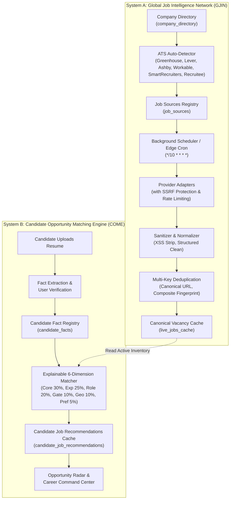

# ApplyVise AI — Global Career Discovery Engine (GCDE)
## Worldwide Employer Career-Site Intelligence, Automated Job Ingestion & Personalized Candidate Matching

**Document Version:** 2.0.0  
**Status:** Implemented & Verified in Core Engine  
**Repository:** `Ayushprakash21/Applywise-AI`  
**Architecture:** Decoupled Ingestion Network (System A) & Explainable Candidate Matcher (System B)  

---

## 1. Executive Summary & Vision

ApplyVise AI is an always-on global career intelligence platform. Rather than acting as a static job board or bookmarking tool, ApplyVise AI continuously discovers and indexes active vacancies directly from official employer career pages, supported Applicant Tracking Systems (ATS), and authorized public feeds. 

Crucially, **job discovery is decoupled from individual candidate resume uploads**:
- **System A (Global Job Intelligence Network):** Operates on independent, scheduled background cycles, systematically polling verified company career portals, standardizing job metadata, performing multi-key deduplication, and managing vacancy lifecycles.
- **System B (Candidate Opportunity Matching Engine):** Reads verified facts from the candidate's profile (`candidate_facts` registry) and computes transparent, explainable alignment against the existing central vacancy inventory. **A new resume upload never initiates synchronous global internet scraping.**

---

## 2. Decoupled Architecture

---

## 3. Supported Source Inventory & ATS Adapters

ApplyVise AI does not make false claims of indexing every website on the internet. We provide concrete, documented adapters for major enterprise ATS platforms and permitted aggregators:

| Source / Provider | Connector Type | Official Endpoint Format | Rate Limit | Permissions Model |
| :--- | :--- | :--- | :--- | :--- |
| **Greenhouse** | `ats_greenhouse` | `https://boards-api.greenhouse.io/v1/boards/{board_token}/jobs?content=true` | 600s | Authorized public ATS API |
| **Lever** | `ats_lever` | `https://api.lever.co/v0/postings/{company}?mode=json` | 600s | Authorized public ATS API |
| **Ashby** | `ats_ashby` | `https://api.ashbyhq.com/posting-api/job-board/{organization_name}` | 600s | Authorized public ATS API |
| **Workable** | `ats_workable` | `https://apply.workable.com/api/v1/widget/accounts/{account}` | 600s | Authorized public ATS API |
| **SmartRecruiters** | `ats_smartrecruiters`| `https://api.smartrecruiters.com/v1/companies/{company}/postings` | 600s | Authorized public ATS API |
| **Recruitee** | `ats_recruitee` | `https://{company}.recruitee.com/api/offers/` | 600s | Authorized public ATS API |
| **Remotive** | `aggregator_api` | `https://remotive.com/api/remote-jobs` | 300s | Public Developer Feed |
| **Arbeitnow** | `aggregator_api` | `https://www.arbeitnow.com/api/job-board-api` | 300s | Public Developer Feed |
| **Jobicy** | `aggregator_api` | `https://jobicy.com/api/v2/remote-jobs` | 300s | Public Developer Feed |
| **Custom Career Sites**| `json_ld` / `custom_web`| Direct URL Extraction via Universal Job Import | Dynamic | Linking only & JSON-LD parsing |

---

## 4. Source Permission Matrix

| Category | Legal / Permission Status | Data Handling & Link Policy |
| :--- | :--- | :--- |
| **Official Employer ATS** | `authorized` | Direct ingestion of public job listings published by employer. Direct link to official application page. |
| **Public Developer Feeds** | `public_feed` | Compliant with published developer terms and robot restrictions. |
| **Candidate Imported** | `linking_only` | Privately extracted at candidate request; visible only in candidate's workspace. |
| **Partner Feeds** | `partner_agreement` | Contractual integration with guaranteed uptime and payload SLAs. |

---

## 5. Database Schema & Persistence

Both the local Express + SQLite runtime (`server/authAndStore.ts`) and Cloudflare Workers + D1 runtime (`worker/d1Store.ts`) maintain strict structural parity across four core tables:

### 1. `company_directory`
Stores verified global employers, detected ATS platforms, and career page endpoints.
- `id` (TEXT PRIMARY KEY)
- `name` (TEXT NOT NULL)
- `domain` (TEXT NOT NULL UNIQUE)
- `careers_url` (TEXT NOT NULL)
- `country` (TEXT NOT NULL DEFAULT 'United States')
- `region` (TEXT NOT NULL DEFAULT 'north_america')
- `industry` (TEXT NOT NULL)
- `detected_ats` (`greenhouse`, `lever`, `ashby`, `workable`, `smartrecruiters`, `recruitee`, `custom_web`)
- `public_board_token` (TEXT)
- `public_endpoint` (TEXT)
- `verification_status` (`verified`, `pending`, `unsupported`)
- `last_checked_at` (TEXT NOT NULL)

### 2. `job_sources`
Tracks configured ingestion connectors, rate limits, health states, and error metrics.
- `id` (TEXT PRIMARY KEY)
- `name` (TEXT NOT NULL)
- `company_id` (TEXT REFERENCES company_directory(id))
- `category` (`official_careers`, `ats_boards`, `public_feeds`, etc.)
- `adapter_type` (`ats_greenhouse`, `ats_lever`, `ats_ashby`, `ats_workable`, etc.)
- `permission_status` (`authorized`, `public_feed`, `linking_only`)
- `health_status` (`healthy`, `empty`, `degraded`, `rate_limited`, `offline`)
- `total_discovered`, `total_active`, `error_count`

### 3. `live_jobs_cache`
The canonical global repository of normalized, deduplicated vacancies.
- `id` (TEXT PRIMARY KEY)
- `source`, `source_job_id`
- `title`, `company`, `location`, `country`, `region`
- `work_arrangement` (`remote`, `hybrid`, `onsite`)
- `employment_type` (`full-time`, `part-time`, `contract`, `internship`)
- `experience_level` (`entry`, `mid`, `senior`, `lead`, `executive`)
- `salary_raw`, `salary_min`, `salary_max`, `salary_currency`
- `url`, `canonical_url`
- `description`, `requirements` (JSON), `preferred_skills` (JSON), `tags` (JSON)
- `source_type` (`official_employer`, `authorized_aggregator`, `candidate_imported`)
- `lifecycle_status` (`DISCOVERED`, `ACTIVE`, `UPDATED`, `EXPIRING`, `EXPIRED`, `REMOVED`)
- `published_at`, `first_seen_at`, `retrieved_at`, `expires_at`, `is_active`

### 4. `candidate_job_recommendations`
Stores cached explainable match scores and dimensional breakdown per candidate.
- `user_id` (TEXT REFERENCES users(id))
- `vacancy_id` (TEXT NOT NULL)
- `match_score` (INTEGER 0–100)
- `algorithm_version` (TEXT DEFAULT '2.0.0')
- `core_skill_score` (0–30), `experience_score` (0–25), `role_alignment_score` (0–20), `qualification_score` (0–10), `geo_compatibility_score` (0–10)
- `matching_skills` (JSON array), `missing_skills` (JSON array), `mandatory_gaps` (JSON array)
- `recommendation_reason` (TEXT NOT NULL)
- `is_bookmarked`, `is_applied`, `is_dismissed`

---

## 6. Candidate Opportunity Matching Engine (COME)

ApplyVise AI enforces a strict, transparent 6-dimension scoring formula with zero score fabrication:

$$\text{MatchScore} = \text{CoreSkills} (30) + \text{Experience} (25) + \text{RoleFit} (20) + \text{MandatoryGate} (10) + \text{GeoMode} (10) + \text{Preferences} (5)$$

### 1. Core Technical & Domain Skills (Weight: 30%)
Compares candidate verified skills from the Candidate Fact Registry against job requirements.
- Match ratio computes exact fraction: $S_{\text{core}} = \text{round}\left(\frac{|M|}{|M| + |U|} \times 30\right)$.
- Matched skills and missing skills are stored and displayed explicitly.

### 2. Experience Level & Seniority (Weight: 25%)
Evaluates verified total years of experience against role requirements:
- Mid-level (3+ years), Senior (5+ years), Lead/Staff (8+ years), Principal/Executive (10+ years).
- Substantial seniority gaps receive honest fractional scores (e.g. 4/25 for 1 year vs Staff).

### 3. Role & Title Alignment (Weight: 20%)
Calculates token-based Jaccard similarity between candidate target role/current title and the opening title.

### 4. Mandatory Qualifications Gate (Weight: 10% + Hard Penalty)
Checks for explicit disqualifying criteria:
- Visa sponsorship requirements vs employer support.
- Hard security clearances (e.g. active TS/SCI).
- Mandatory professional licenses or degrees.
- **Strict Penalty Rule:** If an unsatisfied mandatory requirement is detected, score is capped at $\le 45\%$ (`Low Fit`), preventing unqualified candidates from receiving inflated match scores.

### 5. Geographic & Work Mode Compatibility (Weight: 10%)
- Fully remote roles: 10/10.
- Country/city match for hybrid/onsite: 10/10.
- Cross-country mismatch requiring relocation: 5/10.
- Unmet remote preference: 2/10.

### 6. Candidate Preferences (Weight: 5%)
Evaluates compensation minimums and industry preferences.

### Alignment Tiers
- **Strong Fit:** $85\% - 100\%$
- **Good Fit:** $70\% - 84\%$
- **Moderate Fit:** $50\% - 69\%$
- **Low Fit:** $< 50\%$

---

## 7. Security & Ingestion Safeguards

1. **SSRF Protection (`isSafePublicUrl`):**
   Blocks loopback (`127.0.0.1`, `localhost`), IPv6 loopback (`::1`), private ranges (RFC 1918 `10.x`, `172.16-31.x`, `192.168.x`), and link-local cloud metadata services (`169.254.169.254`).
2. **HTML Sanitization (`sanitizeIngestedDescription`):**
   Strips `<script>`, `<iframe>`, `<style>`, event handlers, and javascript link protocols while preserving clean typography (`
`, `<ul>`, `<li>`, `<strong>`, `<h3>`).
3. **Multi-Key Deduplication (`deduplicateJobs`):**
   Computes composite fingerprints (`company::title::location`) and canonical URL hashes to merge duplicate postings from multiple aggregators or redundant crawls.
4. **Stale Pruning Lifecycle:**
   Listings unverified for more than 14 days are marked `EXPIRED` or pruned during cleanup passes.

---

## 8. Implementation Status & Verification

- [x] **ATS Adapters:** Greenhouse, Lever, Ashby, Workable, SmartRecruiters, Recruitee, Remotive, Arbeitnow, Jobicy.
- [x] **ATS Auto-Detector:** URL-based detection with token and endpoint resolution.
- [x] **Runtime Parity:** Full SQLite (`server/authAndStore.ts`) and Cloudflare D1 (`worker/d1Store.ts`) schema & method implementations.
- [x] **Admin Console Integration:** Global Source Intelligence tab featuring real-time KPIs, Geographic Coverage Matrix, Registered Source table, and "+ Add Career Site" modal.
- [x] **Opportunity Radar:** Country, Source Type, and Work Mode filtering; ATS provenance badges; verified "Apply on Company Site" links; and explainable 6-dimension score breakdown drawer.
- [x] **Test Coverage:** All 23 GCDE tests and 349 regression tests passing cleanly with zero failures.
