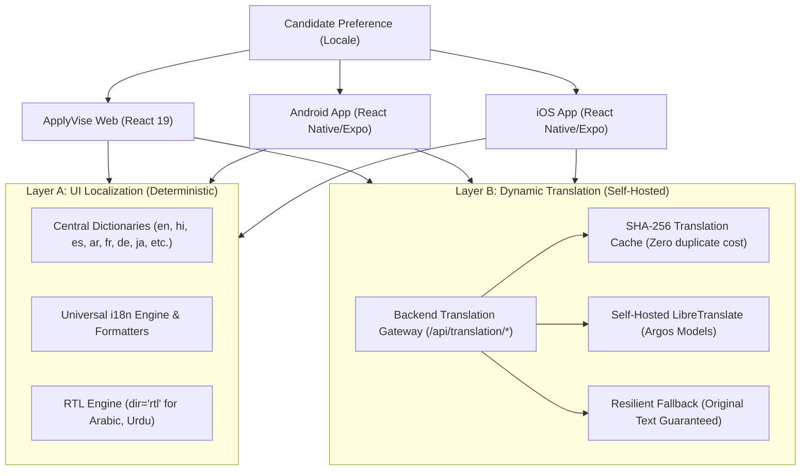

# ApplyVise AI — Universal Language Engine Architecture

**Document Version:** 1.0.0  
**Status:** Approved Architecture  
**Scope:** Web, Android, iOS, Admin Console, AI Copilot, Career Atlas  
**Architecture Lead:** Autonomous CTO & Localization Architect

---

## 1. System Mission & Philosophy

ApplyVise AI is an enterprise career intelligence platform serving candidates worldwide. To democratize career navigation, candidates must interact with the platform in their native language—whether accessing via web or mobile apps.

Rather than relying on generic, third-party browser plugins (such as Google Translate) that distort layout, break hydration, and leak candidate data, ApplyVise implements a **Two-Layer Localization Architecture**:

---

## 2. Layer A: Platform UI Localization

- **Deterministic Dictionaries:** User interface strings (navigation, form labels, buttons, validation, empty states, tooltips) originate from structured, versioned translation dictionaries.
- **Zero Hallucination UI:** No machine translation is applied to static UI keys, avoiding mistranslated buttons or misleading interface terminology.
- **Lazy Loading & Fallbacks:** If a specific key in a regional dialect is incomplete, the system cascades gracefully to standard national locale (e.g. `hi-IN`) and ultimately to canonical English (`en-US`).
- **Locale-Aware Formatting:** Numbers, dates, times, and percentages respect regional typographic conventions via standard `Intl` APIs. Currency codes and exact numerical salaries remain untampered.

---

## 3. Layer B: Dynamic Content Translation Gateway

For real-time dynamic career information (job descriptions, vacancy postings, Career Atlas transition notes):
- **Self-Hosted LibreTranslate Engine:** Open-source Argos Translate models running in containerized isolation.
- **SHA-256 Deduplication Cache:** Every translation request computes `hash = SHA256(sourceLang + targetLang + text)`. Subsequent requests resolve in `<1ms` from cache.
- **Candidate Fact Protection:** Candidate names, employer names, product names, URLs, and verified credentials are never modified by machine translation.
- **Original Content Inspection:** Candidates always have single-click access to the original source text.

---

## 4. Multiplatform Symmetrical Contract

A single user setting (`preferred_locale`) dictates the language across:
1. Web Browser (`localStorage` + authenticated backend profile)
2. Android (`AsyncStorage` / `SecureStore` + backend sync)
3. iOS (`AsyncStorage` / `SecureStore` + backend sync)

Switching locale on any device immediately syncs across the candidate's ecosystem.
